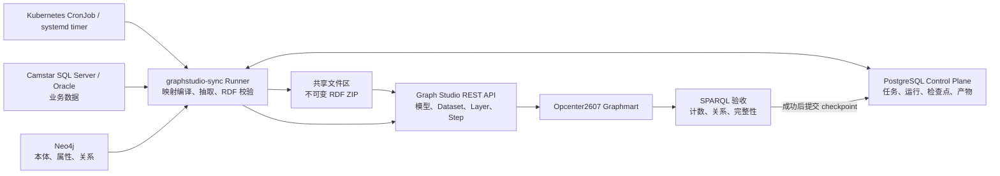

# Camstar → Graph Studio 持续同步架构

## 结论

建议增加 PostgreSQL，但它应该是**同步控制面**，不是 Camstar 数据的全量中转仓库。
业务数据仍然从可配置的 Camstar SQL Server/Oracle 读取，Neo4j 仍然是本体和映射的事实来源，
同步工具将两者编译为 RDF 批次，经共享文件区导入 Graph Studio。

不建议默认走 `SQL Server → PostgreSQL 全量镜像 → RDF`，因为这会引入第二套业务
Schema、双写一致性、更多存储和额外时延。只有当后续需要多源联表、长周期历史拉链、
数据质量修复或隔离 Camstar 负载时，才单独增加可选的 staging schema。

## 当前盘点

使用 `python scripts/graphstudio_sync.py plan` 对当前环境进行了只读盘点：

- Neo4j：318 个本体类、4,483 个属性、796 条本体关系。
- SQL Server：318/318 个本体类都能匹配物理表。
- 属性与物理列的可确定映射为 4,451/4,483（99.29%），剩余 32 个需要显式映射或确认为计算属性。
- 当前已映射的 318 张表中 70 张非空，总行数约 632。
- Graphmart `Opcenter2607` 在线，已发现 Graph Lakehouse 可访问的共享文件连接 `localShare`。
- 当前 SQL Server 实测未启用 Change Tracking、CDC、Snapshot Isolation 或 Read Committed Snapshot；
  因而目前只能安全执行小表流式快照，不能把生产策略切换成数据库原生增量。

因此，当前测试库可以生成完整 RDF 快照。但生产 Camstar 可能存在亿级历史表，
不能把测试库的规模结论直接外推到生产；执行器必须先按表策略审核，再决定全量、
水位、追加、CDC 或排除。Kafka 仍只在秒级 SLA 下引入。

## 目标架构



### 各组件责任

| 组件 | 责任 | 不承担的责任 |
|---|---|---|
| SQL Server / Oracle | Camstar 业务数据的唯一事实来源 | 不保存 Graph Studio 运行状态 |
| Neo4j | 本体类、属性、关系和物理映射 | 不复制 Camstar 全量数据 |
| PostgreSQL | 任务配置、run ledger、checkpoint、锁、artifact URI | 默认不存业务全表 |
| Runner | 生成映射清单、抽取、RDF 序列化、发布、验收 | 不长期持有调度循环 |
| CronJob | 定时触发、失败重试、禁止重叠 | 不决定 checkpoint |

## 每次同步的事务边界

1. 获取 PostgreSQL advisory lock，创建 `run` 记录。
2. 从 Neo4j 编译出确定的 manifest：类、物理表、主键、属性列、外键关系。
3. 计算 ontology hash 和 source schema hash；出现不明确映射时失败，不猜测。
4. 从 SQL Server 以一致性视图抽取，生成 Turtle/N-Triples 和 manifest。
5. 本地解析回读，并执行 SHACL/必填、URI 唯一性和引用完整性检查。
6. 生成不可变的 `run_id.zip`，上传到 Graph Studio 与 Graph Lakehouse 共享的文件连接。
7. 通过 API 创建新 Dataset，将现有 LoadDatasetStep 原子切换到新 catalog entry，然后 reload。
8. 用 SPARQL 检查类数、实例数、关系数和关键样本。
9. 只有第 8 步成功后才提交 checkpoint；失败时保留旧 Dataset/Step 和旧 checkpoint。
10. 按保留策略清理旧产物，默认保留最近 3 个成功版本和所有失败 manifest。

## 全量与增量策略

### 当前：按表策略的流式基线

- 全部 318 个类使用稳定 URI：`namespace/class/primary-key`。
- PostgreSQL `table_sync_policy` 为每个本体类选择 `snapshot`、`watermark`、
  `append_only`、`cdc` 或 `excluded`；超过行数阈值且没有显式策略时，预览直接失败。
- 源表按主键 keyset 分页，不使用 `OFFSET`，也不会一次 `fetchall()` 整张表。
- 默认每批 10,000 行，同时以 64 MiB 为 RDF 分片软上限；每个分片完成 Turtle
  回读、哈希和计数后写入 `sync_batch` 台账。
- 引用完整性检查只在配置的上限内保留精确目标 URI 集；超过上限会降级为明确告警，
  不会无限占用内存。
- 当前完整快照仍可用 Dataset 版本切换自然表达删除；增量策略需要 tombstone 或
  周期性 reconciliation 才能处理源端删除。

这解决了“读取/序列化时内存随整表增长”的问题，但不等同于已经完成生产 CDC。
初始基线期间的数据库一致性边界仍需使用 SQL Server Snapshot/CDC LSN 或 Oracle SCN；
`watermark`、`append_only`、`cdc` 目前是可审核策略和执行保护，连接器的增量消费、
断点恢复命令及删除事件应用属于下一阶段。在连接器上线前，预览遇到这三种策略会在
连接源表前失败，绝不会退化为全表扫描；暂不导入的亿级表应显式选择 `excluded`。

### 增量能力证据与窗口

- `probe-incremental` 只读查询 SQL Server `sys.databases`、`sys.change_tracking_tables`、
  `cdc.change_tables`，或 Oracle 当前 SCN、UNDO 与表级 Flashback Versions 可访问性。
- 每次探测保存到 `source_capability_snapshot`，因此页面上显示的是带时间戳的数据库事实，
  不是根据表名推测的能力。
- `plan-incremental` 在抽取前冻结上界：CT version、CDC LSN、Oracle SCN 或水位列最大值；
  窗口写入 `incremental_window`。
- 没有 checkpoint 时窗口标记为 `baseline_required`；CT/CDC checkpoint 早于数据库最小
  有效位置时标记为 `blocked`，必须重新做基线，不能跳过丢失区间。
- 窗口规划本身不会抽取业务行、提交 checkpoint 或修改 Graph Studio；源库的
  CT/CDC/Flashback 配置必须由 DBA 审核。
- `preview-incremental` 已具备四种有界读取器：SQL Server Change Tracking、SQL Server
  CDC、Oracle Flashback Versions 和普通 watermark/append-only。读取结果统一为带主键、
  操作类型和恢复位置的 JSONL change envelope；删除记录进入 tombstone 计数。
- 增量预览包会回读 JSONL、验证 ZIP CRC 并记录 run/artifact，但明确设置
  `checkpointCommitted=false`。只有未来 Graph Studio 应用和 SPARQL 验收成功后才能提交检查点。

### 触发升级到增量的条件

任一条连续出现时再升级：快照超过 5 GB、单次超过 30 分钟、源库压力不可接受，
或业务要求 5 分钟内可见。升级路径是：

- 优先使用 SQL Server Change Tracking/CDC，没有 CDC 的低频表才使用 watermark + row hash。
- 按领域和变化率分区：配置/建模数据低频，WIP/历史数据高频。
- 增量批次和周期性全量 reconciliation 并存，避免长期漂移。
- 若要求秒级，使用 CDC 事件流/Kafka，不再使用 cron 作数据通道。

## 调度和运维

- Kubernetes 环境优先 CronJob，设置 `concurrencyPolicy: Forbid`；非 K8s 使用 systemd timer 或 Windows Task Scheduler。
- Runner 仍需要 PostgreSQL advisory lock，因为调度器重试和手工触发仍可能重叠。
- 密码放入 Kubernetes Secret/Vault，生产不使用镜像内 `.env`。
- 输出结构化日志和 metrics：run 时长、源行数、RDF 三元组数、失败阶段、数据新鲜度。
- 告警条件：连续失败、超过 SLA 未成功、行数异常变化、本体/Schema hash 未审批变更。

## 管理界面

- `/sync`：主入口，包含总览、连接、任务、映射、运行记录和系统设置。
- `/ontology`：保留的本体建模工作台。
- 菜单由 `graphsync.menu_item` 驱动，可在系统设置中修改名称、排序和启用状态。
- 连接页仅维护脱敏元数据；密码始终通过 `env://...` 引用环境变量。
- 映射页显示未解析属性及多候选/未解析关系，人工规则分别写入 `mapping_override` 和 `relationship_override`。

## 业务图谱与上下文闭包

完整本体和业务实例范围分开管理。Neo4j 中的完整本体继续作为模型层；实例层由 PostgreSQL 中的 `graph_profile`、`profile_class`、`profile_relationship` 控制，避免把全部本体类和历史表无差别扩展成高成本、低价值的实例图谱。

- 对象角色：`core`、`context`、`reference`、`on_demand`、`excluded`。
- 关系强度：`core`、`context`、`weak`、`on_demand`。只有前两类关系可启用上下文遍历，数据库约束禁止弱关联驱动遍历。
- 孤立对象策略：拒绝、隔离、允许、仅被引用时导入。默认隔离，不静默丢弃，也不直接污染核心层。
- 闭包预算：全局最大深度、每个种子的上下文节点上限、单次运行总节点上限、每条关系的扇出上限。
- 发布门禁：核心对象必须有物理表映射；必需上下文关系必须唯一解析；对象角色和关系强度必须经过审核。

初始配置 `opcenter2607-core` 只把 `Product` 和 `MfgOrder` 设为核心种子，审核状态为草案。系统从实际本体映射列出关系候选，但不会根据名称自动认定核心关系。类级闭包预览不读取 Camstar 数据、不写 Graph Studio；关系审核完成后，实例抽取器才能使用该配置。

上下文质量问题记录在 `context_validation`，跨批次暂时找不到目标的引用记录在 `pending_reference`，供后续批次补齐或进入隔离层。

### 治理后的业务对象层

`camstar_curated` 是 Graph Studio 实例数据的受控来源，不是 Camstar 全库镜像。对象必须先在 `graphsync.data_contract` 中声明物理来源、主键、业务键、投影字段、必填字段、增量时间列、预览上限和目标图层；对象之间的字段连接及业务语义由 `relationship_contract` 单独审批。

首批纵向切片包含：

- `ProductId` 是 Product 物理主键；`ProductBaseId + ProductRevision` 暂作为待业务确认的业务键。
- `MfgOrderId` 是 MfgOrder 物理主键，`MfgOrderName` 是业务键。
- `MfgOrder.ProductId` 表示订单目标产品，是必需上下文候选。
- `MfgOrder.BeginProductId` 表示订单起始产品，是可选上下文候选。

治理预览读取量受每个契约的 `preview_row_limit` 约束，并将聚合结果记录到 `curation_run` 和 `data_quality_result`。契约、对象角色、必需关系未批准，数据存在主键/必填错误，预览被截断，或必需目标无法解析时，`publishable=false`。当前阶段不提供 curated materialize/apply 命令，避免审核前写入业务投影。

### 字段演进与依赖治理

字段增加和减少不能直接修改投影表或 Graph Studio。`data_contract_field` 给每个字段分配稳定 `field_key`，显示名称变化不改变身份；字段分别记录物理来源、curated 目标、数据类型、是否可空、键角色、生命周期、转换规则和本体属性。`asset_dependency` 将字段与 curated 列、关系契约、本体属性、Graph Studio 谓词、查询、看板、API 和 Action 绑定，避免删字段时只检查数据库而漏掉语义和应用依赖。

所有变更先写入 `schema_change_request/schema_change_item` 并执行静态影响分析：

- 新增可空字段通常向后兼容；新增必填字段必须有默认值和回填方案。
- 废弃字段保留读取能力，给下游迁移窗口；存在活动依赖时不能直接退役。
- 重命名通过稳定 ID 和别名迁移，不能用“删除旧字段再新增”的方式破坏 URI/谓词连续性。
- 改类型、改键、改来源属于破坏性变更，必须有迁移及回滚方案。
- 审批只把计划推进到 `approved`，不会自动执行源库 DDL、curated DDL 或 Graph Studio 发布。实际迁移运行在下一阶段由 `schema_migration_run` 编排，并在质量门禁通过后切换版本。

这相当于 Palantir Ontology 中“对象类型/属性/链接类型 + 数据血缘 + 受控发布”的最小闭环。当前仍刻意缺少直接写回 Camstar 的 Action：读取治理稳定后再增加 API Action Service，并将授权、审计、幂等和补偿事务独立设计。

## 工具边界和路线图

### 已落地

- `doctor`：只读检查 Neo4j、SQL Server、Graph Studio 和 PostgreSQL 连通性。
- `plan`：输出类/表覆盖、属性映射率、行数估算和推荐模式。
- `preview`：使用主键 keyset 分页生成完整、确定性的 OWL/Turtle 模型与分片 RDF ZIP，执行逐分片回读、URI、引用和数据类型校验，全程不调用 Graph Studio 写接口。
- 表级同步策略、安全阈值、批大小/RDF 分片配置，以及 `sync_batch` 分片审计台账。
- SQL Server CT/CDC、Oracle SCN/Flashback 能力探测，以及可持久化的增量窗口规划。
- PostgreSQL 控制面 DDL，本地 Compose 和暂停状态的 Kubernetes CronJob 模板。
- 业务图谱角色、关系强度、孤立策略、闭包预算和只读类级闭包规划。
- Product/MfgOrder 数据契约、独立关系语义、治理预览和质量门禁审计。
- 字段目录、字段生命周期、跨层依赖图、Schema 兼容性分析以及复核/审批流程。
- Product/MfgOrder 子图的 RDF 导出和 API 导入已作为端到端概念验证。

### 分阶段开发路线

| 阶段 | 交付物 | 当前状态 | 写入边界 |
|---|---|---|---|
| 1. Schema 演进中心 | 字段目录、依赖影响、兼容性判定、复核与审批 | 已完成 | 只写控制面，不改业务投影 |
| 2. 治理物化 | approved 版本的契约迁移、分批回填、校验、指针回滚 | 已完成实现 | 仅写 `camstar_curated`，不写源库 |
| 3. 发布工程 | Dev/UAT/Prod 环境、不可变制品、Graph Studio 蓝绿 Dataset、SPARQL 验收 | 已完成实现 | 验收成功后记录活动部署；环境开关默认关闭 |
| 4. 可观测与血缘 | 字段级 lineage、SLA、数据新鲜度、质量趋势、告警 | 已完成实现 | 只写审计与指标 |
| 5. Action Service | 经授权的 Camstar API 写回、幂等、审计、补偿挂钩 | 已完成实现 | 不允许数据库直写；定义与全局开关默认关闭 |

五个阶段的工具链已经完成，但“实现完成”不等于“生产门禁已通过”。当前 Product/MfgOrder 契约、对象角色与两条关系仍为草案，因此治理物化会明确返回阻断项，不读取全表、不写治理快照。阶段 2 实际运行前仍必须完成 Product/MfgOrder 业务键、`ORDERED_PRODUCT`/`BEGIN_PRODUCT` 关系语义，以及 SQL Server CT/CDC 或 Oracle SCN 增量策略的业务和 DBA 审批。生产源库中的亿级表必须逐表确认策略、主键/水位列和历史窗口；未确认时保持阻断，不能回退为全表扫描。

### 通用属性投影（控制面 v14）

属性投影解决“扩展属性表中的字段需要表现为 Product、Workflow 等主对象属性”的通用需求，而不把每个物理表直接提升为图谱节点。一个投影契约包含目标数据契约、关联表、主对象关联键、投影字段和多值/缺失/字段冲突策略；高级模式可声明多跳等值 Join、过滤及确定性排序。它不接受原始 SQL，因此规则可校验、可版本化、可审计，也能统一编译为 SQL Server 或 Oracle 查询。

- 单表场景只配置 `目标列 = 来源别名.列` 和逐行字段映射；复合键可配置多行。
- 多跳场景使用受限 Join 计划，所有 Schema、表、别名和列名必须通过标识符校验。
- 预览只读取有限主对象，并明确记录匹配、缺失和多匹配数量；不写 Camstar 或 Graph Studio。
- 物化按主对象键分批查询关联表，避免 SQL Server 2,100 参数上限和单次大结果集；已批准投影随不可变治理版本固化。
- 默认禁止同名覆盖。显式 `overwrite` 可用关联值替代主值，`coalesce` 仅在主值为空时补齐。
- 主对象的增量事件会刷新其投影；仅扩展表发生变化时，由定时治理版本进行一致性重算。生产上如需秒级更新，应为扩展表另行配置 CDC 失效队列，不能用全表轮询替代。

### 阶段 2：不可变治理版本

- Schema 变更按 `analysis_ready → reviewed → approved → applying → applied` 推进；应用操作只更新字段目录和数据契约版本，不对 Camstar 执行 DDL。
- 数据按物理主键 keyset 分页，每批写入 `materialization_batch`，内存占用不随源表总行数增长。
- 超过阈值的大表禁止日常快照：必须已有活动基线，并消费经过 CRC/JSONL 校验的 CT、CDC、Oracle SCN 或水位增量包。执行器先在 PostgreSQL 内复制上一不可变版本，再按幂等 URI 合并 upsert/delete；Graph Studio 验收成功后才把窗口标记为 committed 并推进 checkpoint。
- 每次物化生成独立 `curated_release`；对象与关系写入通用 JSONB 版本表，新增或减少字段不需要在亿级宽表上执行阻塞式 `ALTER TABLE`。
- 必填、主键和必需关系验证通过后才进入 `ready`；激活只切换 `curated_release_activation`。回滚恢复上一指针，不重新扫描 Camstar。
- `active_object` 和 `active_relationship` 是下游唯一稳定读取入口。

### 阶段 3：环境晋级与蓝绿发布

- `deployment_environment` 默认提供 Dev、UAT、Prod；同一 `curated_release_id` 必须按顺序晋级。
- 发布制品是经过 Turtle 回读和 ZIP 校验的不可变 RDF，哈希写入 `deployment_release`。
- 每次选择与当前相反的 blue/green 槽位，新建 Dataset/Layer/LoadDatasetStep，保留上一部署资产。
- Graphmart reload 无失败资产且 SPARQL 对象计数达到制品预期后，部署才标记为 `active`。
- 三个环境的 `apply_enabled` 初始均为 false；必须在 UAT 明确启用，工具才会调用 Graph Studio 写接口。

### 阶段 4：字段血缘、健康与告警

物化记录 `源表.源列 → data_contract_field → curated release` 的运行时映射，制品准备和 Graph Studio 发布继续扩展到 RDF/Layer。健康检查覆盖活动版本新鲜度、对象/关系/隔离数量、未解析关系、失败 Schema 迁移、最近发布失败和 Action 积压。告警使用稳定 fingerprint 去重，支持 open、acknowledged、resolved 生命周期；当前渠道默认为空，不会自动向外部系统发送消息。

### 阶段 5：Camstar Action Service

Action 定义只保存 HTTP 方法、Camstar API 路径、输入 Schema、角色、审批和重试策略，不允许保存或执行 SQL。请求必须提供幂等键；实际动作需要 Action 定义启用、全局 `actions.apply_enabled=true`、角色匹配和独立审批人。调用使用 `CAMSTAR_API_BASE_URL` 与 Token/Basic Auth，并发送 `Idempotency-Key`。响应只保存状态码、响应哈希和结果字段名，避免把业务或敏感响应复制到控制面。补偿 Action 已预留显式关联，不做不可审计的自动反向 SQL。

## 命令

```powershell
python scripts/graphstudio_sync.py doctor --output outputs/graphstudio/sync_doctor.json
python scripts/graphstudio_sync.py plan --output outputs/graphstudio/full_sync_plan.json
python scripts/graphstudio_sync.py init-db
python scripts/graphstudio_sync.py compile-catalog
python scripts/graphstudio_sync.py dry-run --job camstar-full
python scripts/graphstudio_sync.py preview --job camstar-full
python scripts/graphstudio_sync.py probe-incremental --job camstar-full
python scripts/graphstudio_sync.py plan-incremental --job camstar-full
python scripts/graphstudio_sync.py preview-incremental --job camstar-full
python scripts/graphstudio_sync.py preview-curation --profile opcenter2607-core

# 启动可选 PostgreSQL 控制面
$env:PGSQL_PASSWORD = '<secret>'
docker compose -f deploy/graphstudio-sync/compose.postgres.yaml up -d
```

Kubernetes 调度模板现在故意处于暂停状态，避免在全量 `sync` 命令完成前误调度。
