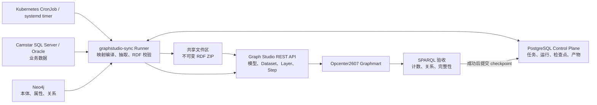

# Camstar → Graph Studio 持续同步架构

## 结论

建议增加 PostgreSQL，但它应该是**同步控制面**，不是 Camstar 数据的全量中转仓库。
业务数据仍然从可配置的 Camstar SQL Server/Oracle 读取，Neo4j 仍然是本体和映射的事实来源，
同步工具将两者编译为 RDF 批次，经共享文件区导入 Graph Studio。

不建议默认走 `SQL Server → PostgreSQL 全量镜像 → RDF`，因为这会引入第二套业务
Schema、双写一致性、更多存储和额外时延。只有当后续需要多源联表、长周期历史拉链、
数据质量修复或隔离 Camstar 负载时，才单独增加可选的 staging schema。

## 当前盘点

使用 `python scripts/graphstudio_sync.py plan` 对当前环境进行了只读盘点：

- Neo4j：318 个本体类、4,483 个属性、796 条本体关系。
- SQL Server：318/318 个本体类都能匹配物理表。
- 属性与物理列的可确定映射为 4,451/4,483（99.29%），剩余 32 个需要显式映射或确认为计算属性。
- 当前已映射的 318 张表中 70 张非空，总行数约 632。
- Graphmart `Opcenter2607` 在线，已发现 Graph Lakehouse 可访问的共享文件连接 `localShare`。
- 当前 SQL Server 实测未启用 Change Tracking、CDC、Snapshot Isolation 或 Read Committed Snapshot；
  因而目前只能安全执行小表流式快照，不能把生产策略切换成数据库原生增量。

因此，当前测试库可以生成完整 RDF 快照。但生产 Camstar 可能存在亿级历史表，
不能把测试库的规模结论直接外推到生产；执行器必须先按表策略审核，再决定全量、
水位、追加、CDC 或排除。Kafka 仍只在秒级 SLA 下引入。

## 目标架构



### 各组件责任

| 组件 | 责任 | 不承担的责任 |
|---|---|---|
| SQL Server / Oracle | Camstar 业务数据的唯一事实来源 | 不保存 Graph Studio 运行状态 |
| Neo4j | 本体类、属性、关系和物理映射 | 不复制 Camstar 全量数据 |
| PostgreSQL | 任务配置、run ledger、checkpoint、锁、artifact URI | 默认不存业务全表 |
| Runner | 生成映射清单、抽取、RDF 序列化、发布、验收 | 不长期持有调度循环 |
| CronJob | 定时触发、失败重试、禁止重叠 | 不决定 checkpoint |

## 每次同步的事务边界

1. 获取 PostgreSQL advisory lock，创建 `run` 记录。
2. 从 Neo4j 编译出确定的 manifest：类、物理表、主键、属性列、外键关系。
3. 计算 ontology hash 和 source schema hash；出现不明确映射时失败，不猜测。
4. 从 SQL Server 以一致性视图抽取，生成 Turtle/N-Triples 和 manifest。
5. 本地解析回读，并执行 SHACL/必填、URI 唯一性和引用完整性检查。
6. 生成不可变的 `run_id.zip`，上传到 Graph Studio 与 Graph Lakehouse 共享的文件连接。
7. 通过 API 创建新 Dataset，将现有 LoadDatasetStep 原子切换到新 catalog entry，然后 reload。
8. 用 SPARQL 检查类数、实例数、关系数和关键样本。
9. 只有第 8 步成功后才提交 checkpoint；失败时保留旧 Dataset/Step 和旧 checkpoint。
10. 按保留策略清理旧产物，默认保留最近 3 个成功版本和所有失败 manifest。

## 全量与增量策略

### 当前：按表策略的流式基线

- 全部 318 个类使用稳定 URI：`namespace/class/primary-key`。
- PostgreSQL `table_sync_policy` 为每个本体类选择 `snapshot`、`watermark`、
  `append_only`、`cdc` 或 `excluded`；超过行数阈值且没有显式策略时，预览直接失败。
- 源表按主键 keyset 分页，不使用 `OFFSET`，也不会一次 `fetchall()` 整张表。
- 默认每批 10,000 行，同时以 64 MiB 为 RDF 分片软上限；每个分片完成 Turtle
  回读、哈希和计数后写入 `sync_batch` 台账。
- 引用完整性检查只在配置的上限内保留精确目标 URI 集；超过上限会降级为明确告警，
  不会无限占用内存。
- 当前完整快照仍可用 Dataset 版本切换自然表达删除；增量策略需要 tombstone 或
  周期性 reconciliation 才能处理源端删除。

这解决了“读取/序列化时内存随整表增长”的问题，但不等同于已经完成生产 CDC。
初始基线期间的数据库一致性边界仍需使用 SQL Server Snapshot/CDC LSN 或 Oracle SCN；
`watermark`、`append_only`、`cdc` 目前是可审核策略和执行保护，连接器的增量消费、
断点恢复命令及删除事件应用属于下一阶段。在连接器上线前，预览遇到这三种策略会在
连接源表前失败，绝不会退化为全表扫描；暂不导入的亿级表应显式选择 `excluded`。

### 增量能力证据与窗口

- `probe-incremental` 只读查询 SQL Server `sys.databases`、`sys.change_tracking_tables`、
  `cdc.change_tables`，或 Oracle 当前 SCN、UNDO 与表级 Flashback Versions 可访问性。
- 每次探测保存到 `source_capability_snapshot`，因此页面上显示的是带时间戳的数据库事实，
  不是根据表名推测的能力。
- `plan-incremental` 在抽取前冻结上界：CT version、CDC LSN、Oracle SCN 或水位列最大值；
  窗口写入 `incremental_window`。
- 没有 checkpoint 时窗口标记为 `baseline_required`；CT/CDC checkpoint 早于数据库最小
  有效位置时标记为 `blocked`，必须重新做基线，不能跳过丢失区间。
- 窗口规划本身不会抽取业务行、提交 checkpoint 或修改 Graph Studio；源库的
  CT/CDC/Flashback 配置必须由 DBA 审核。
- `preview-incremental` 已具备四种有界读取器：SQL Server Change Tracking、SQL Server
  CDC、Oracle Flashback Versions 和普通 watermark/append-only。读取结果统一为带主键、
  操作类型和恢复位置的 JSONL change envelope；删除记录进入 tombstone 计数。
- 增量预览包会回读 JSONL、验证 ZIP CRC 并记录 run/artifact，但明确设置
  `checkpointCommitted=false`。只有未来 Graph Studio 应用和 SPARQL 验收成功后才能提交检查点。

### 触发升级到增量的条件

任一条连续出现时再升级：快照超过 5 GB、单次超过 30 分钟、源库压力不可接受，
或业务要求 5 分钟内可见。升级路径是：

- 优先使用 SQL Server Change Tracking/CDC，没有 CDC 的低频表才使用 watermark + row hash。
- 按领域和变化率分区：配置/建模数据低频，WIP/历史数据高频。
- 增量批次和周期性全量 reconciliation 并存，避免长期漂移。
- 若要求秒级，使用 CDC 事件流/Kafka，不再使用 cron 作数据通道。

## 调度和运维

- Kubernetes 环境优先 CronJob，设置 `concurrencyPolicy: Forbid`；非 K8s 使用 systemd timer 或 Windows Task Scheduler。
- Runner 仍需要 PostgreSQL advisory lock，因为调度器重试和手工触发仍可能重叠。
- 密码放入 Kubernetes Secret/Vault，生产不使用镜像内 `.env`。
- 输出结构化日志和 metrics：run 时长、源行数、RDF 三元组数、失败阶段、数据新鲜度。
- 告警条件：连续失败、超过 SLA 未成功、行数异常变化、本体/Schema hash 未审批变更。

## 管理界面

- `/sync`：主入口，包含总览、连接、任务、映射、运行记录和系统设置。
- `/ontology`：保留的本体建模工作台。
- 菜单由 `graphsync.menu_item` 驱动，可在系统设置中修改名称、排序和启用状态。
- 连接页仅维护脱敏元数据；密码始终通过 `env://...` 引用环境变量。
- 映射页显示未解析属性及多候选/未解析关系，人工规则分别写入 `mapping_override` 和 `relationship_override`。

## 工具边界和路线图

### 已落地

- `doctor`：只读检查 Neo4j、SQL Server、Graph Studio 和 PostgreSQL 连通性。
- `plan`：输出类/表覆盖、属性映射率、行数估算和推荐模式。
- `preview`：使用主键 keyset 分页生成完整、确定性的 OWL/Turtle 模型与分片 RDF ZIP，执行逐分片回读、URI、引用和数据类型校验，全程不调用 Graph Studio 写接口。
- 表级同步策略、安全阈值、批大小/RDF 分片配置，以及 `sync_batch` 分片审计台账。
- SQL Server CT/CDC、Oracle SCN/Flashback 能力探测，以及可持久化的增量窗口规划。
- PostgreSQL 控制面 DDL，本地 Compose 和暂停状态的 Kubernetes CronJob 模板。
- Product/MfgOrder 子图的 RDF 导出和 API 导入已作为端到端概念验证。

### 下一个实现里程碑

1. 在生产源库执行盘点，对所有超过阈值的表显式确认策略、主键/水位列和历史窗口。
2. 由 DBA 审核并在生产候选库启用 CT/CDC 或 Oracle Flashback；随后实现变更行抽取、删除事件 RDF 应用与断点恢复。
3. 审核 32 个未确定属性、159 个多候选关系、72 个未解析关系，以及预览报告中的引用和数据类型告警。
4. 实现幂等的 `sync --job camstar-full --apply`，包含蓝绿 Dataset 切换、SPARQL 验收和回滚。
5. 通过 UAT 后取消 CronJob 模板的 `suspend: true`；秒级 SLA 再评估 Kafka。

## 命令

```powershell
python scripts/graphstudio_sync.py doctor --output outputs/graphstudio/sync_doctor.json
python scripts/graphstudio_sync.py plan --output outputs/graphstudio/full_sync_plan.json
python scripts/graphstudio_sync.py init-db
python scripts/graphstudio_sync.py compile-catalog
python scripts/graphstudio_sync.py dry-run --job camstar-full
python scripts/graphstudio_sync.py preview --job camstar-full
python scripts/graphstudio_sync.py probe-incremental --job camstar-full
python scripts/graphstudio_sync.py plan-incremental --job camstar-full
python scripts/graphstudio_sync.py preview-incremental --job camstar-full

# 启动可选 PostgreSQL 控制面
$env:PGSQL_PASSWORD = '<secret>'
docker compose -f deploy/graphstudio-sync/compose.postgres.yaml up -d
```

Kubernetes 调度模板现在故意处于暂停状态，避免在全量 `sync` 命令完成前误调度。
